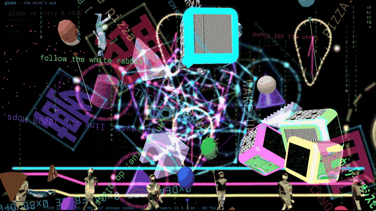
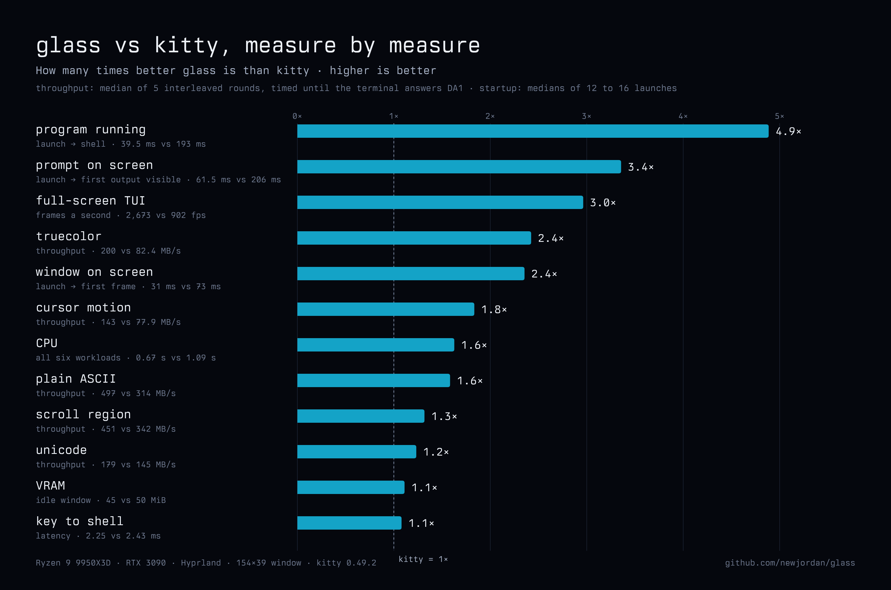

<p align="center">
  <a href="https://github.com/newjordan/glass/releases/download/v0.1.0/glass-mindseye.mp4"></a>
</p>

<h1 align="center">glass</h1>

<p align="center"><b>A GPU terminal that takes in every graphics dialect and draws it as layers, 3D and video.</b></p>

<p align="center">
  <a href="#install">Install</a> ·
  <a href="docs/PERFORMANCE.md">Performance</a> ·
  <a href="docs/GLASS_DIALECT.md">The dialect</a> ·
  <a href="docs/CONFIG.md">Configuration</a> ·
  <a href="docs/FAQ.md">FAQ</a>
</p>

A program runs in a pseudo-terminal, and what it writes comes in through
**open intake**: glass takes in the graphics dialects programs already
speak, and its own, and **expands** them into one picture store drawn as
layers above and below the text. That means the text grid plus pictures,
glows, particles, lit 3D scenes, glTF models with their animations, and
video.

The film above ([watch it, 95 s](https://github.com/newjordan/glass/releases/download/v0.1.0/glass-mindseye.mp4))
is a program writing escape codes into a pty: up to 9,662 layers a frame
at 60 fps. glass drew it and recorded it itself.

## Fast

On one machine (Ryzen 9 9950X3D, RTX 3090, Hyprland, a 154×39 window).
Medians; **bold is the best of the four**. The throughput rows and the CPU
row are medians of five interleaved rounds through `bench/run-tput.sh`; the
startup, key-latency and VRAM rows have been run for glass and kitty only.

| | glass | ghostty 1.4.0 | kitty 0.49.2 | foot 1.24.0 |
| --- | --- | --- | --- | --- |
| Program's first output on screen, from launch | **46.1 ms** | — | 185 ms | — |
| Window on screen, from launch | **27.4 ms** | — | 72.1 ms | — |
| Program running, from launch | **34.0 ms** | — | 174 ms | — |
| Plain ASCII through the pty | 682 MB/s | **959 MB/s** | 312 MB/s | 429 MB/s |
| Unicode | 218 MB/s | **283 MB/s** | 143 MB/s | 140 MB/s |
| Truecolor | **262 MB/s** | 239 MB/s | 86 MB/s | 352 MB/s |
| Cursor motion | **239 MB/s** | 218 MB/s | 76 MB/s | 418 MB/s |
| Scroll region | 686 MB/s | **1,137 MB/s** | 342 MB/s | 385 MB/s |
| Full-screen TUI frames | 3,792 fps | **3,807 fps** | 922 fps | 6,296 fps |
| CPU over all six workloads | **0.55 s** | 0.80 s | 1.05 s | 0.53 s |
| VRAM, idle window | **45 MiB** | — | 50 MiB | — |
| Key press to the program | **2.20 ms** | — | 2.25 ms | — |
| Key press to the program, while it floods output | **3.0 ms** | — | 38.6 ms | — |



- **First output on screen** is the one to judge by: launch until what the
  program writes first is visible, caught frame by frame on a 240 Hz
  output (one frame, 4.2 ms). The GPU driver takes about a tenth of a
  second to open on NVIDIA, so until it has, glass draws the window on the
  CPU: the background first, then your shell's text, with the same fonts
  and colours the GPU draws them in. The GPU's first frame takes over with
  nothing visibly changing.
- **Where glass is behind.** ghostty is ahead on plain ASCII (1.4×),
  scroll region (1.7×) and unicode (1.3×), and the two are level on
  full-screen TUI frames. glass leads on truecolor and cursor motion, and
  spends the least CPU of the three GPU terminals over the set — 0.55 s
  against ghostty's 0.80 s. foot, a CPU renderer, is the fastest here on
  truecolor, cursor motion and TUI frames.
- Throughput above a few hundred MB/s is not something you feel; the
  startup and key-latency rows are. Those are the ones to judge by, and
  they have not been measured against ghostty yet.
- One machine, and ghostty's rounds vary widely on it (its ASCII ran 846 to
  1,139 MB/s across five). Medians of fewer than five rounds do not
  reproduce. On macOS, against Ghostty 1.4.0 on an M4 Pro, glass is ahead
  on every measure but wide text, which is about even
  ([docs/PERFORMANCE.md](docs/PERFORMANCE.md#macos)).
  Other GPUs and CPUs: not yet.

How each was measured, and every caveat: [docs/PERFORMANCE.md](docs/PERFORMANCE.md).
The harness and every run: [`bench/`](bench/).

## What it takes in

| Dialect | What glass takes in |
| --- | --- |
| APC graphics (`ESC _ G …`) | transmit and place, every transmission medium (direct, file, temporary file, shared memory), chunking, compression, z-index above and below the text, source rectangles, Unicode placeholders, relative placements, animation, the full delete table |
| DCS sixel | sixel pictures, with raster attributes and aspect |
| OSC 1337 inline images | `File=` and the multipart form: PNG, JPEG, GIF, TIFF, WebP, BMP, ICO, TGA, PNM |
| CSI u keyboard | the progressive key flags, alongside legacy key bytes |
| OSC 8 | hyperlinks, opened with Ctrl+click |
| tmux passthrough | wrapped sequences are unwrapped and taken in |
| glass's own dialect (`ESC _ glass;…`) | layers, groups, glows, rings and lines, particles, lit primitives, 3D scenes with chrome and liquid materials, glTF 2.0 models with skinning and animations, tweens glass plays itself, video, charts |

Pictures follow the text: they move with scroll regions and the alternate
screen, and keep their place through reflow on resize. Text written over
an in-cell picture hides only the cells it covers.

What the file and shared-memory media may read, and what they delete, is
spelled out in the [FAQ](docs/FAQ.md#can-a-program-make-glass-read-my-files).

## Try it from a shell

In a glass window, glass's own dialect:

```sh
# a soft violet glow under this line and the two below it
printf '\033_glass;layer;id=1;k=glow;c=8844ccff;add=1;at=0,0,80,3\033\\'

# warm sparks rising from the rows below
printf '\033_glass;layer;id=2;k=particles;c=ffd080;n=120;size=2;life=3;rise=30;sway=12;at=0,1,80,4\033\\'

# a glowing ring with a line across it, pinned to the window in pixels
printf '\033_glass;layer;id=5;k=ring;c=40b0ff;lw=2;glow=7;add=1;px=400,200,240,240\033\\'
printf '\033_glass;layer;id=6;k=line;c=ff60c0;lw=1.5;glow=4;add=1;a=0.785;px=370,319,300,2\033\\'

# a liquid-chrome sphere: a 3D scene, described as JSON
printf '\033_glass;scene;id=8;px=700,60,320,320;s=320;v=320;%s\033\\' \
  "$(printf '%s' '{"v":1,"scene":{"camera":{"clear":[0,0,0,1]},"nodes":[{"id":1,"mesh":{"kind":"sphere","segments":48},"scale":[1.6,1.6,1.6],"color":[0.92,0.94,1,1],"chrome":1,"liquid":0.6}]}}' | base64 -w0)"

# the ring breathes orange and back, for ever: glass plays the tween itself
printf '\033_glass;tween;layer=5;c=ff8800;dur=1.5;ease=sine-in-out;repeat=forever;yoyo=1\033\\'

# take it all down
printf '\033_glass;remove;all=1\033\\'
```

And a picture through APC graphics, 40 columns wide (any PNG):

```sh
printf '\033_Ga=T,f=100,c=40;%s\033\\' "$(base64 -w0 picture.png)"
```

Other terminals ignore APC strings they don't know, so a program can send
glass's dialect blind, or ask first with `hello`. The whole dialect, with
examples: [docs/GLASS_DIALECT.md](docs/GLASS_DIALECT.md).

## Install

On Linux:

```sh
curl -fsSL https://github.com/newjordan/glass/releases/latest/download/install.sh | sh
```

It installs into `~/.local/glass`, links `~/.local/bin/glass`, and adds the
desktop entry and icons under `~/.local/share`. `sh install.sh --uninstall`
takes it out again.

On Arch Linux, from the AUR:

```sh
yay -S glass-term-bin    # the release binary
yay -S glass-term        # built from source
```

<a id="build"></a>From source, with Rust 1.95 or newer:

```sh
git clone https://github.com/newjordan/glass && cd glass
cargo build --release -p glass-term      # the binary is target/release/glass
```

glass needs a Wayland or X11 desktop with a Vulkan driver, fontconfig, and
`wl-clipboard` (Wayland) or `xclip` (X11) for copy and paste.

## First run

```sh
glass                     # your shell
glass -e htop             # a command
glass --class dev --title build --working-directory ~/src --hold -e make
```

The first launch writes `~/.config/glass/glass.conf` with every setting at
its default: the font, its size, the palette, padding, opacity, and a
background image with its tint. Every key, the `GLASS_*` environment
variables and the keyboard shortcuts are in [docs/CONFIG.md](docs/CONFIG.md).

The flags follow `xdg-terminal-exec`, so glass can be your desktop's
default terminal: put `glass.desktop` first in `~/.config/xdg-terminals.list`.

## See what it does

From a clone, inside a glass window:

```sh
cargo run --release -p glass-term --example glass_sampler     # a tour of every dialect
cargo run --release -p glass-term --example glass_mindseye    # the film, live
```

The sampler walks through each dialect in under two minutes, then glass's
own: lit solids orbiting the text, a tesseract, a glass knot, an orrery
under the text, a chart, a video. `--list` names its scenes, `--scene
knot,orrery` plays only those, `--loop` repeats the show. Add `-- --surreal`
to the film for its video cubes and dancing figures; the figures' models
are not in the repository (`MINDSEYE_ASSETS` names where they are).

## Platforms

| | |
| --- | --- |
| Linux, Wayland, NVIDIA | tested (one machine: RTX 3090, Hyprland, Omarchy) |
| Linux, Wayland, AMD or Intel | should work through Vulkan; not tested yet |
| Linux, X11 | supported, without the early CPU frame; not tested for this release |
| macOS, Apple Silicon | runs through Metal (tested on an M4 Pro, macOS 26); build from source, no packaged build yet |
| Windows | not yet |

## Layout

- `crates/term` (`glass-term`, the `glass` binary): the terminal: the
  engine, the pty, keys, and `src/intake/`, the dialect adapters and the
  picture store.
- `crates/glass` (`glass-window`): the GPU window.
- `crates/gpu` (`glass-gpu`): rendering.
- `crates/stage` (`glass-stage`): layers, scenes and the shared types.
- `docs/`: [the design](docs/GLASS_TERM.md), [the dialect](docs/GLASS_DIALECT.md),
  [configuration](docs/CONFIG.md), [performance](docs/PERFORMANCE.md),
  [FAQ](docs/FAQ.md).
- `crates/alacritty-terminal`: glass's fork of Alacritty's terminal library
  (below).
- `bench/`: the harness behind every number above, and its results.
- `site/`: the landing page.

## Built on

- **[Alacritty](https://alacritty.org)'s terminal library,
  `alacritty_terminal`**, by Christian Duerr, Joe Wilm and the Alacritty
  contributors.
  - It keeps the grid, the scrollback and what every escape sequence means.
  - glass carries a fork of version 0.26.0 in
    [`crates/alacritty-terminal`](crates/alacritty-terminal), Apache-2.0 as
    upstream. Its [README](crates/alacritty-terminal/README.md) says where
    it comes from, and its [CHANGES.md](crates/alacritty-terminal/CHANGES.md)
    lists every change.
  - The window, the renderer, the intake, the dialect and the fast paths
    that write text, colours and cursor moves straight into the grid are
    glass's own.
- **[vte](https://crates.io/crates/vte)**, the escape-sequence parser under
  it, by the same project.
- **[wgpu](https://wgpu.rs)** for the GPU, **[winit](https://crates.io/crates/winit)**
  for the window, **[portable-pty](https://crates.io/crates/portable-pty)**
  for the pseudo-terminal, **[ratatui](https://ratatui.rs)**'s buffer for
  the cells, and **[mimalloc](https://github.com/microsoft/mimalloc)** for
  memory.

## License

MIT, © Jordan Newman. See [LICENSE](LICENSE). `crates/alacritty-terminal`,
the fork of Alacritty's library, is Apache-2.0, as upstream
([its licence](crates/alacritty-terminal/LICENSE-APACHE)). The binary also
contains crates under their own licences; the release tarballs list them
all, with their texts, in `THIRD_PARTY.md`.
