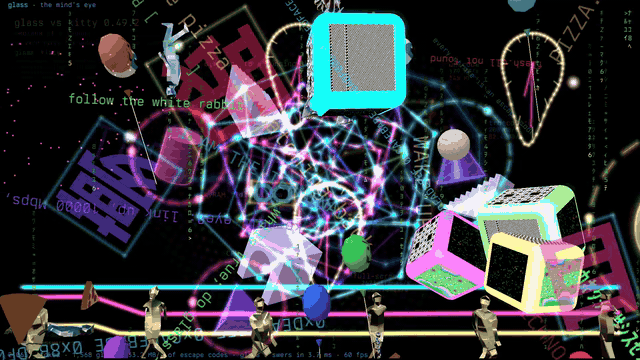

<p align="center">
  <a href="https://github.com/newjordan/glass/releases/download/v0.1.0/glass-mindseye.mp4"></a>
</p>

<h1 align="center">glass</h1>

<p align="center"><b>A GPU terminal. Programs draw text, pictures, layers, 3D and video by writing escape sequences.</b></p>

<p align="center">
  <a href="#install">Install</a> ·
  <a href="#run">Run</a> ·
  <a href="#graphics">Graphics</a> ·
  <a href="docs/GLASS_DIALECT.md">The dialect</a> ·
  <a href="docs/CONFIG.md">Configuration</a> ·
  <a href="docs/PERFORMANCE.md">Performance</a> ·
  <a href="docs/FAQ.md">FAQ</a>
</p>

A program runs in a pseudo-terminal. glass reads the graphics dialects that
programs already speak, plus its own, and expands them into one picture
store. The window draws that store as layers above and below the text grid:
pictures, glows, particles, lit 3D scenes, glTF models with their
animations, and video.

The film above ([watch it](https://github.com/newjordan/glass/releases/download/v0.1.0/glass-mindseye.mp4))
is a program writing those escape codes into a pty. glass drew it and
recorded it. How the published timing runs were taken, and the tables from
those runs, is [docs/PERFORMANCE.md](docs/PERFORMANCE.md). The harness is
[`bench/`](bench/).

## Install

### Linux, from a release

```sh
curl -fsSL https://github.com/newjordan/glass/releases/latest/download/install.sh | sh
```

The script checks the tarball against `SHA256SUMS`, installs under
`~/.local/glass`, links `~/.local/bin/glass`, and adds the desktop entry
and icons under `~/.local/share` (or `$XDG_DATA_HOME`). Override the
locations with `GLASS_INSTALL_DIR`, `GLASS_BIN_DIR` and `XDG_DATA_HOME`.

```sh
sh install.sh --version v0.2.0   # a specific release
sh install.sh --uninstall        # remove what the script installed
```

### Arch Linux

```sh
yay -S glass-term-bin    # the release binary
yay -S glass-term        # built from source
```

The package files are in [`packaging/aur/`](packaging/aur/).

### From source

glass builds with Rust 1.95 or newer (the `rust-version` in the workspace
manifest). A Vulkan driver is required at run time on Linux. Wayland and
X11 client libraries are loaded when the window opens, not when it is
compiled.

```sh
git clone https://github.com/newjordan/glass
cd glass
cargo build --release -p glass-term
# binary: target/release/glass
```

Runtime dependencies on Linux:

| Need | Used for |
| --- | --- |
| A Vulkan driver | The GPU window |
| fontconfig, and a monospace font (`fc-match monospace`) | Text |
| `wl-clipboard` on Wayland, or `xclip` on X11 | Copy and paste |

On macOS the window uses Metal. Fonts come from the system font folders,
and the clipboard uses `pbcopy` and `pbpaste`. There is no packaged macOS
build. Windows is not supported.

`cargo test --workspace --locked` runs the automated tests. GPU drawing
tests skip themselves when no adapter is available.

## Run

```sh
glass
glass -e htop
glass --class dev --title build --working-directory ~/src --hold -e make
glass --help
```

With no command, glass starts `$SHELL`. Flags follow `xdg-terminal-exec`,
so glass can be the desktop's default terminal: put `glass.desktop` first
in `~/.config/xdg-terminals.list`.

| Flag | Meaning |
| --- | --- |
| `-e`, `--` | The command and its arguments. Everything after this is the program's. |
| `--title`, `-T` | Window title. `glass htop` uses `htop`; a shell uses `glass`. |
| `--class`, `--app-id` | Wayland app id and X11 class. Default `glass`. |
| `--working-directory`, `--dir`, `-d` | Directory the program starts in. |
| `--hold` | Keep the window open after the program exits. |
| `-h`, `--help` | Print usage and exit 0. |

`--flag=value` and `--flag value` both work. A bare word starts the
command: `glass htop` is the program `htop`, not an option.

The first launch writes `$XDG_CONFIG_HOME/glass/glass.conf` (or
`~/.config/glass/glass.conf`) with every setting at its default: font,
size, palette, padding, opacity, and an optional background image. glass
does not overwrite a file that is already there. `GLASS_CONFIG` names a
different file. `GLASS_*` variables override the file. A line
`include <path>` reads another file at that point; later lines override
it. `~/` and paths relative to the including file work.

`pkill -USR1 -x glass` reloads the file in every open window. Keys, the
environment variables and the shortcuts are in
[docs/CONFIG.md](docs/CONFIG.md).

## Graphics

glass takes the sequence in, turns it into one description of what to
show, and draws that. Other terminals ignore APC strings they do not
know, so a program can send glass's own dialect without asking, or ask
first with `hello`.

| Dialect | What it carries |
| --- | --- |
| APC graphics (`ESC _ G …`) | Transmit and place. Direct payload, file, temporary file and shared memory. Chunking, compression, z-index above and below the text, source rectangles, Unicode placeholders, relative placement, animation, and the delete table. |
| DCS sixel | Sixel pictures, with raster attributes and aspect. |
| OSC 1337 | Inline images, `File=` and the multipart form: PNG, JPEG, GIF, TIFF, WebP, BMP, ICO, TGA, PNM. |
| CSI u | Progressive keyboard flags, alongside legacy key bytes. |
| OSC 8 | Hyperlinks. Ctrl+click opens `http`, `https`, `file` and `mailto` only. |
| tmux passthrough | Wrapped sequences are unwrapped and taken in. |
| glass (`ESC _ glass;…`) | Layers, groups, glows, rings, lines, particles, lit primitives, 3D scenes with chrome and liquid materials, glTF 2.0 models with skinning and animations, tweens glass plays itself, video and charts. |

Pictures follow the text. They move with scroll regions and the alternate
screen, and they keep their place through reflow when the window is
resized. Text written over an in-cell picture hides only the cells it
covers. Growing the window pulls history back onto the screen, and a
picture stays on the text it was anchored to.

What the file and shared-memory forms may read, and what they delete, is
in the [FAQ](docs/FAQ.md#can-a-program-make-glass-read-my-files).

In a glass window:

```sh
# a soft violet glow under this line and the two below it
printf '\033_glass;layer;id=1;k=glow;c=8844ccff;add=1;at=0,0,80,3\033\\'

# warm sparks rising from the rows below
printf '\033_glass;layer;id=2;k=particles;c=ffd080;n=120;size=2;life=3;rise=30;sway=12;at=0,1,80,4\033\\'

# a glowing ring with a line across it, pinned to the window in pixels
printf '\033_glass;layer;id=5;k=ring;c=40b0ff;lw=2;glow=7;add=1;px=400,200,240,240\033\\'
printf '\033_glass;layer;id=6;k=line;c=ff60c0;lw=1.5;glow=4;add=1;a=0.785;px=370,319,300,2\033\\'

# the ring breathes orange and back: glass plays the tween itself
printf '\033_glass;tween;layer=5;c=ff8800;dur=1.5;ease=sine-in-out;repeat=forever;yoyo=1\033\\'

# take it all down
printf '\033_glass;remove;all=1\033\\'
```

A picture through APC graphics, 40 columns wide:

```sh
printf '\033_Ga=T,f=100,c=40;%s\033\\' "$(base64 -w0 picture.png)"
```

The whole dialect, with the reply tokens and the error codes, is
[docs/GLASS_DIALECT.md](docs/GLASS_DIALECT.md).

From a clone, inside a glass window:

```sh
cargo run --release -p glass-term --example glass_sampler    # each dialect, then glass's own
cargo run --release -p glass-term --example glass_mindseye   # the film, live
```

`glass_sampler --list` names its scenes. `--scene knot,orrery` plays those,
and `--loop` repeats the show. `glass_mindseye --surreal` adds the video
cubes and figures. Those models are not in the repository;
`MINDSEYE_ASSETS` names the directory that holds them.

## Hermes Agent plugin

[`plugins/glass`](plugins/glass/README.md) gives
[Hermes Agent](https://github.com/NousResearch/hermes-agent) (`>=0.19.0`) a
session-scoped surface in glass: cards, bar charts, images, multi-panel
pages, 3D scenes, animated glTF models, camera tweens, video frames, and
click and scroll events. Outside glass, the tools answer in plain text and
do not claim a frame was drawn.

```sh
hermes plugins install newjordan/glass/plugins/glass
python3 -m unittest discover -s plugins/glass/tests -t plugins/glass
```

## Platforms

| Platform | Status |
| --- | --- |
| Linux, Wayland, NVIDIA | Exercised on the machine the published runs used (RTX 3090, Hyprland, Omarchy). |
| Linux, Wayland, AMD or Intel | The window asks Vulkan for an adapter. Not part of those published runs. |
| Linux, X11 | Supported through winit. There is no early CPU frame on X11. |
| macOS, Apple Silicon | Metal. Build from source. No packaged build. |
| Windows | Not supported. |

On Wayland, the window is mapped before the GPU driver has finished
opening. The first frames are drawn on the CPU, in the same fonts and
colours, and the GPU's first frame replaces them.

## Layout

| Path | Crate | What it is |
| --- | --- | --- |
| `crates/term` | `glass-term` | The `glass` binary: the pty, the keyboard, and `src/intake/`, the dialect adapters and the picture store. |
| `crates/glass` | `glass-window` | The window, input, config, and the early CPU frame. |
| `crates/gpu` | `glass-gpu` | wgpu pipelines: quads, meshes, pictures, the atlas. |
| `crates/stage` | `glass-stage` | Layer, scene and shape types shared by the window and the terminal. |
| `crates/alacritty-terminal` | `glass-alacritty-terminal` | Fork of Alacritty's terminal library, version 0.26.0. The library name is still `alacritty_terminal`. |
| `crates/vte` | `vte` | The escape-sequence parser under that library. |
| `docs/` | | [Design](docs/GLASS_TERM.md), [dialect](docs/GLASS_DIALECT.md), [configuration](docs/CONFIG.md), [performance](docs/PERFORMANCE.md), [FAQ](docs/FAQ.md). |
| `bench/` | | The measurement harness and its recorded runs. |
| `plugins/glass` | | The Hermes Agent plugin. |
| `site/` | | The landing page. Static HTML, no build step. |
| `packaging/` | | The install script, the desktop entry, icons, and the AUR packages. |

## Built on

- **[Alacritty](https://alacritty.org)'s terminal library, `alacritty_terminal`**, by Christian Duerr, Joe Wilm and the Alacritty contributors. It keeps the grid, the scrollback and the meaning of the terminal's escape sequences. glass carries a fork of version 0.26.0 in [`crates/alacritty-terminal`](crates/alacritty-terminal), Apache-2.0 as upstream. Its [README](crates/alacritty-terminal/README.md) says where it comes from, and its [CHANGES.md](crates/alacritty-terminal/CHANGES.md) lists every change. The window, the renderer, the intake, the dialect and the fast paths that write text straight into the grid are glass's own.
- **[vte](https://crates.io/crates/vte)**, the parser under that library, by the same project.
- **[wgpu](https://wgpu.rs)** for the GPU, **[winit](https://crates.io/crates/winit)** for the window, **[portable-pty](https://crates.io/crates/portable-pty)** for the pseudo-terminal, **[ratatui](https://ratatui.rs)**'s buffer for the cells, and **[mimalloc](https://github.com/microsoft/mimalloc)** for the allocator.

## License

MIT, © Jordan Newman. See [LICENSE](LICENSE). `crates/alacritty-terminal`,
the fork of Alacritty's library, is Apache-2.0, as upstream
([its licence](crates/alacritty-terminal/LICENSE-APACHE)). The binary also
contains crates under their own licences; the release tarballs list them,
with their texts, in `THIRD_PARTY.md`.
