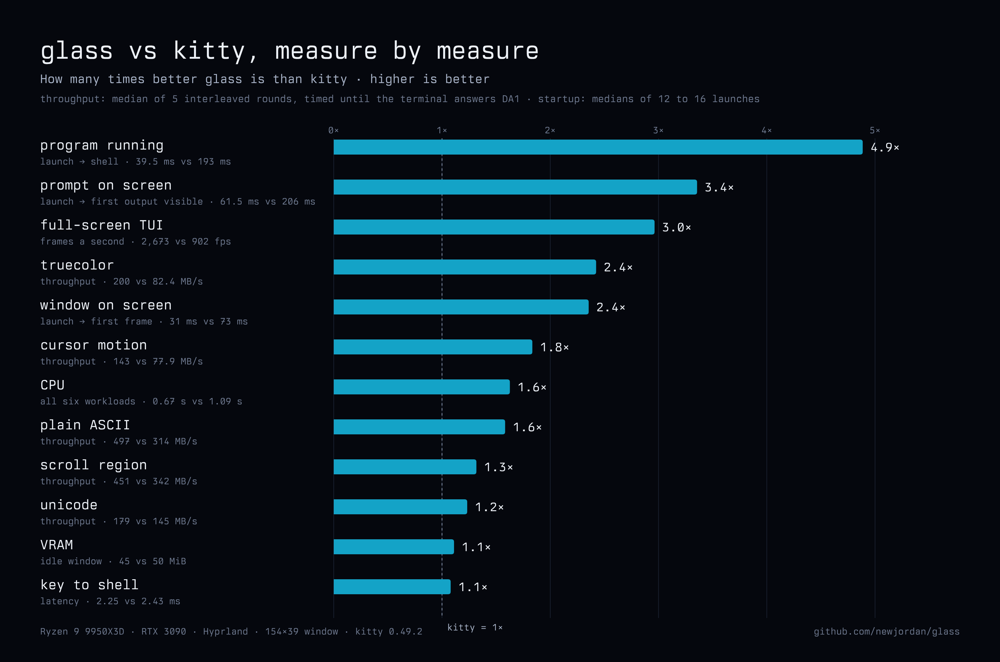

# Performance

Every number glass publishes, how it was measured, and what to keep in mind
when reading it. The harness and the raw results are in [`bench/`](../bench/);
[bench/README.md](../bench/README.md) says how to run it on your machine.

## The numbers

Measured against **kitty 0.49.2**, the only other terminal measured so far,
on one machine: Ryzen 9 9950X3D, RTX 3090, Omarchy (Arch Linux), Hyprland,
a 154×39 window. Medians.

| Measure | glass | kitty 0.49.2 | |
| --- | --- | --- | --- |
| Window on screen, from launch | **31 ms** | 73 ms | 2.4× |
| Program running, from launch | **39.5 ms** | 193 ms | 4.9× |
| Plain ASCII through the pty | **497 MB/s** | 314 MB/s | 1.6× |
| Unicode | **179 MB/s** | 145 MB/s | 1.2× |
| Truecolor | **200 MB/s** | 82 MB/s | 2.4× |
| Cursor motion | **143 MB/s** | 78 MB/s | 1.8× |
| Scroll region | **451 MB/s** | 342 MB/s | 1.3× |
| Full-screen TUI frames | **2,673 fps** | 902 fps | 3.0× |
| CPU over all six workloads | **0.67 s** | 1.09 s | 1.6× less |
| VRAM, idle window | **45 MiB** | 50 MiB | 1.1× less |
| Key press to the program | **2.25 ms** | 2.43 ms | 1.1× |



Every round and every launch behind these is in
[`bench/scoreboard-20261027b.json`](../bench/scoreboard-20261027b.json), and
the raw files are in [`bench/results/2026-10-27/`](../bench/results/2026-10-27/).

## How each was measured

All of it ran on a headless Hyprland output made for the run (1920×1080):
each terminal was launched through `hyprctl` onto it, full-screen in its
tile, one terminal at a time, the terminals taking turns. Each terminal ran
with the machine's own configuration for it. glass and kitty both came up
at 154×39 cells.

### Throughput (`bench/run-tput.sh`, `bench/tput.py`)

- `tput.py` runs inside the terminal. It writes each workload through the
  pty and stops the clock when the terminal answers a DA1 query (`CSI c`),
  so every byte has been parsed, the way vtebench times it.
- Six workloads: plain ASCII (24 MiB), Unicode (16 MiB), truecolor (24
  MiB), cursor motion (16 MiB), a scroll region (16 MiB), and 300
  full-screen TUI frames on the alternate screen, every cell with its own
  background colour. [bench/README.md](../bench/README.md) describes each.
- Within a round, each workload is written three times and the fastest
  pass counts.
- Five rounds, glass and kitty taking turns. The table shows the median of
  the five rounds.
- **Full-screen TUI frames** is 300 frames over the fastest pass's time.

### CPU

The terminal's own CPU time (user and system, from `/proc/<pid>/stat`)
over each workload's counted pass, summed over the six workloads; the
median over the five rounds.

### Startup (`bench/run-startup.sh`)

- Sixteen launches of each terminal through Hyprland, taking turns.
- The clock starts just before the launch command goes to `hyprctl`, so
  Hyprland's own launch time is in both terminals' numbers.
- **Program running** is when the program inside the terminal writes its
  first timestamp.
- **Window on screen** is Hyprland's `openwindow` event, read from its
  event socket as it arrives. Hyprland sends it when the window's first
  buffer arrives.

### VRAM (`bench/run-misc.sh`)

`nvidia-smi`'s figure for an idle window's process.

### Key latency (`bench/run-misc.sh`, `bench/keys.py`)

Forty key presses, each sent to the window through Hyprland
(`send_shortcut`), timed until `keys.py`, running inside the terminal,
reads the byte from the pty. The median of the forty. Hyprland's dispatch
is in both terminals' numbers. This stops at the program reading the key;
it does not include drawing the echo.

## Say this plainly

### What "window on screen" shows

glass shows its window before the GPU driver is ready. The NVIDIA driver
takes about 100 ms to open, so glass draws its background on the CPU first:
the background colour, the background image and its tint, exactly as the
GPU will draw them. The GPU's first frame then replaces it, with nothing
visibly changing.

So 31 ms is when the window, with its real background, is on screen. That
is what Hyprland reports, and it is the same event for kitty. kitty's own
window is up at 73 ms, and its shell runs at 193 ms.

The early frame is drawn on Wayland only. On X11, or if any step of it
fails, glass shows the window with the GPU's first frame, and the program
starts after that frame.

### When the prompt appears

The shell starts at 39.5 ms, while the GPU is still opening; it starts as
soon as the compositor has settled the window's size. The first frame with
text (the prompt) comes when the GPU is ready: about 130 to 180 ms after
launch on this machine, depending on GPU load. That is still sooner than
kitty's shell starts (193 ms), but **it has not been measured as its own
number yet**, for either terminal. A measure for it (launch until the
program's first output is on screen) is being added to `bench/`.

`GLASS_STARTUP_TRACE=1` prints each step of glass's startup on stderr, with
milliseconds since `main`.

### Plain ASCII and the CPU's cache

On CPUs whose dies have last-level caches of different sizes (AMD's X3D
parts), glass keeps its pty read and parse threads on the die with the
largest one. Without that, plain ASCII swung between about 250 and 430
MB/s on this CPU, depending on where the scheduler put the thread.
`GLASS_AFFINITY=off` turns the placement off. On a CPU with one L3, or
several of one size, nothing is placed and nothing changes.

### Only kitty has been measured

alacritty, ghostty, foot and wezterm have not been run through the harness
yet. glass is ahead of kitty on every measure above; that is all these
numbers say. Adding a terminal to the harness is one line
([bench/README.md](../bench/README.md#add-another-terminal)).

### One machine

These numbers come from one machine. Other GPUs and CPUs will differ, and
nothing here has been measured on AMD or Intel graphics, on a laptop, or on
a CPU with a single L3.

### Which build

Startup was measured on the build this repository's commit `42ec6b3`
records. The throughput rounds ran on the development build just before
it, which added the early frame and did not change the pty read path.
[bench/results/2026-10-27/](../bench/results/2026-10-27/) has the details.

## The film

"Mind's eye" is 95 seconds at 1080p and 60 fps. Every frame is a program
(`crates/term/examples/glass_mindseye`) writing escape codes into the pty,
and glass drawing them.

- Up to 9,662 layers a frame.
- 4.4 GB of escape codes in 86 seconds (51 MB/s).
- glass answered each frame in 5.8 ms on average. The program sends each
  frame inside a synchronized update and then waits for glass to answer a
  DA1 before building the next; the numbers in the film's corner are those
  measurements, taken as it runs.
- Recorded by glass itself, through the GPU's encoder (`GLASS_RECORD`).
- 5,699 of 5,700 frames drawn; the recorder repeated one. A frame the
  window is too slow for is repeated, not caught up, so the film keeps the
  wall clock's time and shows a stall as one.

`bench/take-mindseye.sh` records a take of it.

## Reproduce

```sh
cargo build --release -p glass-term
export GLASS=$PWD/target/release/glass
ROUNDS="1 2 3 4 5" bench/run-tput.sh && python3 -I bench/summarize.py
RUNS=16 bench/run-startup.sh
bench/run-misc.sh
```

The harness launches through Hyprland; [bench/README.md](../bench/README.md)
has the requirements, what each script measures, and how to add a terminal.
